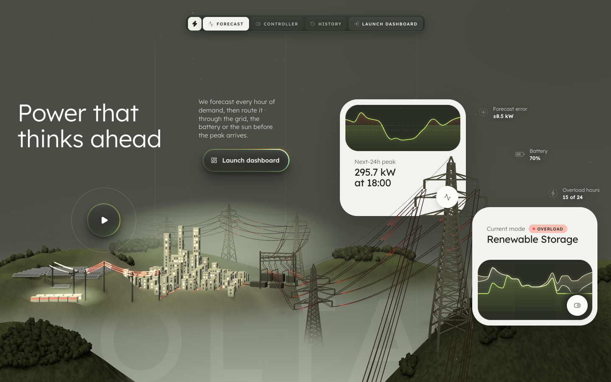
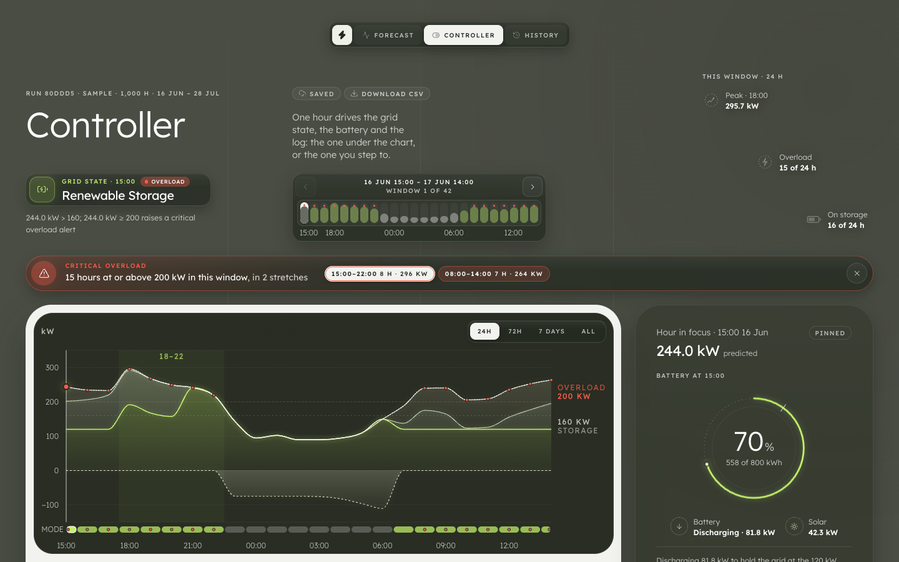
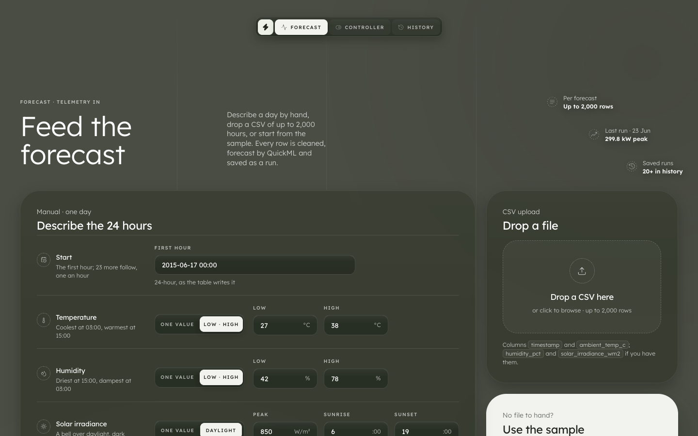
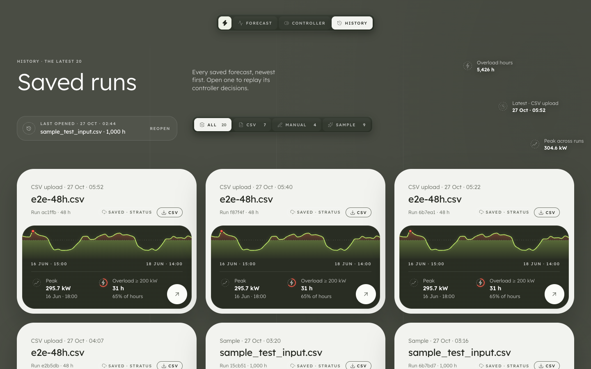
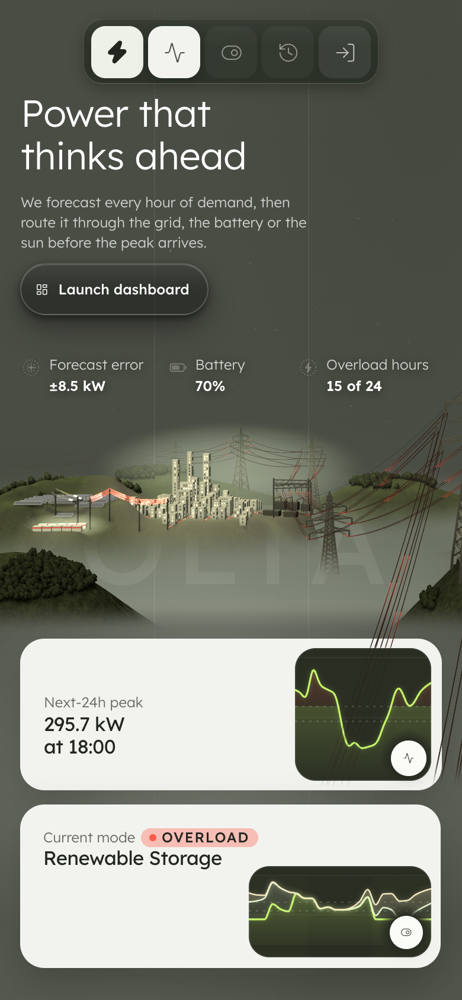
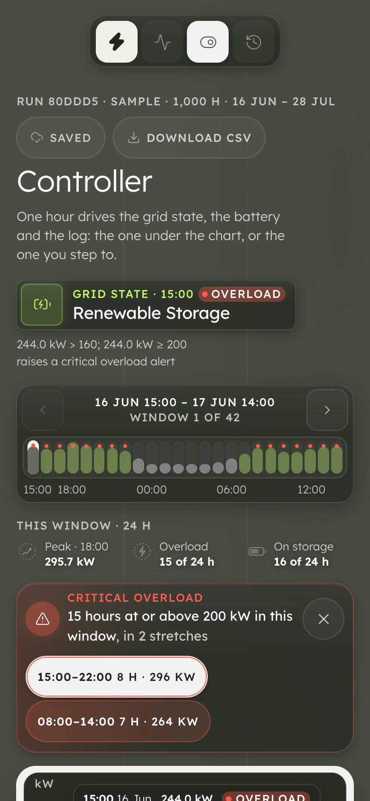
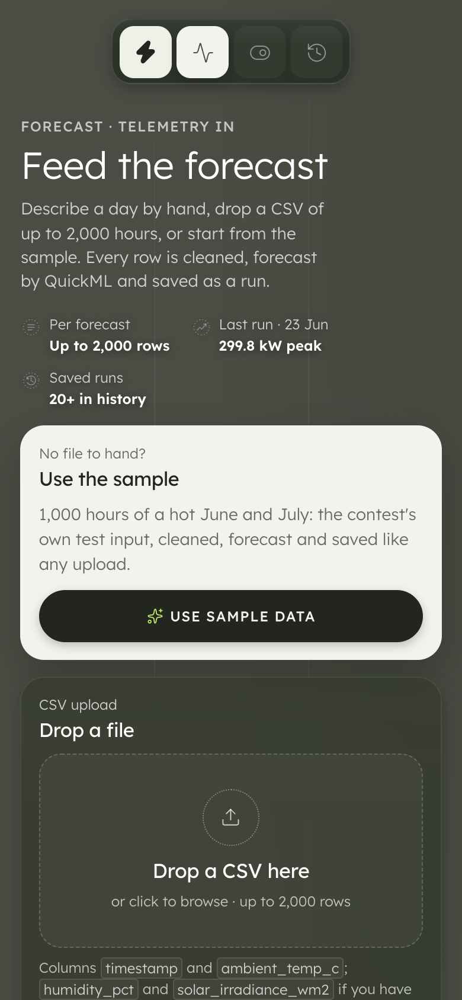
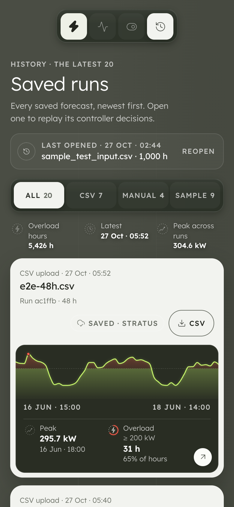
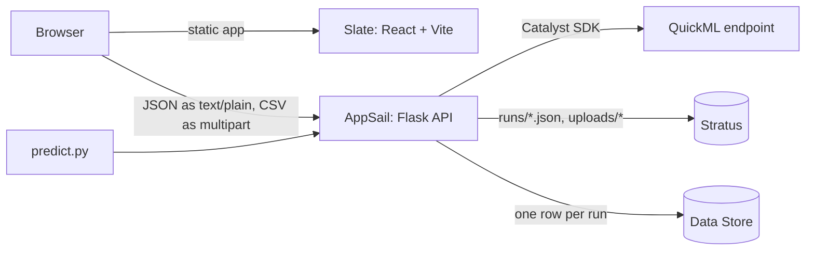

<p align="center">
  
</p>

<p align="center">
  <a href="https://volta.onslate.in"></a>
  
  
  
  
</p>

VOLTA forecasts a microgrid's demand for every hour with a model trained and served by Zoho Catalyst QuickML,
then decides for each hour whether the load runs on the main grid or on renewable storage, and when to raise an
overload alert. Everything runs on Catalyst: the frontend on Slate, the API on AppSail, uploads and runs in
Stratus, run metadata in the Data Store.

## Try it in 30 seconds

Open **[volta.onslate.in](https://volta.onslate.in)**, then **Launch dashboard › Use sample
data**. On the dashboard, look at:

- the **grid-state badge**: Main Grid or Renewable Storage for the hour in focus, with the controller's own reason;
- the **battery ring**: state of charge, and one line on what the battery is doing and why;
- the **overload banner**: every stretch of hours at or above 200 kW, one click away on the chart;
- the **system log**: each mode switch and each overload stretch in the window.

Hover the chart, or step the 24-hour window, and all four follow the same hour.

## What you get

<p align="center">
  
  
</p>
<p align="center">
  
  
</p>
<p align="center">
  
  
  
  
</p>

- a live 24-hour forecast on the landing page, with a 3D grid whose current follows the controller hour by hour
- telemetry in three ways: a form that generates a 24-hour day you can edit row by row, a CSV upload, or the sample
- a cleaning report for every upload: rows in and out, the timestamp formats it read, every fix and every rejected row
- the dashboard: predicted load stacked by source (grid, battery, solar), the 160 and 200 kW lines, the 18–22 window, battery state of charge, overload stretches and a system log
- every run saved, listed in History with its own load curve, and reopenable
- every run's results as a CSV, built in the browser
- works on a phone; the chart there gets a readout, since nobody hovers on glass

## How it maps to the brief

| Requirement ([problem statement §3, §5](docs/PROBLEM_STATEMENT.md)) | Where | Catalyst service |
|---|---|---|
| Train and publish a demand regression model | the endpoint `demand-forecast`, called by [`/api/predict`](docs/api.md) | QuickML |
| Accept telemetry via a live UI form or CSV upload | [`/input`](https://volta.onslate.in/input) | Slate, AppSail |
| Clean, validate and fill missing values | [`backend/cleaning.py`](backend/cleaning.py), with the report on `/input` | AppSail |
| Store uploaded CSV files | `uploads/…` in the bucket `microgrid-uploads` | Stratus |
| Hourly predictions for a 24-hour window | [`/api/forecast`](docs/api.md#post-apiforecast), `window` | AppSail, QuickML |
| Threshold and time-based switching, overload alert | [`backend/controller.py`](backend/controller.py) | AppSail |
| Dashboard: load curve, grid state, battery SoC, alerts | [`/dashboard`](https://volta.onslate.in/dashboard) | Slate |
| System logs | the dashboard's system log; `switch_events` and `overload_alerts` in the API | Slate, AppSail |
| Persist telemetry and runs | runs in `runs/<id>.json`, one metadata row per run in the table `runs` | Stratus, Data Store |
| `predict.py` against the published endpoint | [`predict.py`](predict.py) → AppSail → QuickML | AppSail, QuickML |

## Forecast accuracy

Validation is forward in time, never random: fit on the first 3,200 hours of `train_telemetry.csv`, score on the
last 800. Full tables, ablations and residuals: [docs/model_report.md](docs/model_report.md).

| Model | Features | RMSE, fit (in-sample) | RMSE, validation |
|---|---|---|---|
| Linear regression (OLS) | hour block + cooling hinge (the 6 QuickML columns) | 8.575 | **8.279** |
| Ridge | the same 7 | 8.575 | 8.278 |
| Linear regression (OLS) | hour one-hot + cooling hinge | 8.551 | 8.296 |
| Gradient boosting | the same 7 | 8.249 | 11.469 |
| Random forest | the same 7 | 8.285 | 14.205 |
| LightGBM | the same 7 | 8.339 | 14.407 |

**Why linear wins.** Fitted on all 4,000 rows, demand is a fixed level per block of hours (night, dawn, morning,
day, evening, late), plus 8.54 kW for every °C above 23.95 °C, plus noise with a standard deviation of 8.52 kW
that looks white and Gaussian. So about 8.5 kW RMSE is the floor, and the linear model is already on it. The tree
models can't extend the cooling line past the hottest hour they saw: the fit split tops out at 34.3 °C, while 43%
of validation hours, and 45% of the test hours, are above 30 °C.

**Features sent to QuickML:** `blk_dawn`, `blk_morning`, `blk_day`, `blk_evening`, `blk_late` (night is the
reference) and `cool_24` = max(0, T − 24 °C). One module builds them for the training CSV, `predict.py` and the
app, and a test keeps the three identical. The published endpoint agrees with the fitted formula to 0.121 kW RMS
over the 1,000 sample rows. QuickML's own evaluation of the deployed model: RMSE 8.71 kW, R² 0.971 (pipeline
demand-linear, V1).

**Reproduce:**

```sh
python predict.py --input sample_test_input.csv --output out.csv   # timestamp,target_demand_kw, one row per input
python test_eval.py                                                # prints SUCCESS
```

`predict.py` needs no credentials: it posts to the AppSail API, which holds the QuickML key. A timeout,
connection error, 5xx or gateway 408 is retried: 3 attempts, 10 s and then 30 s apart, with one stderr line per
retry. If every attempt fails it raises an error. It never falls back to a made-up curve. The API sends at most
1,000 distinct hours per QuickML call, so a 1,000-row run costs one call, or none when its rows are already cached.
Worst case: 3 calls, one per attempt.

## Architecture



A forecast request is cleaned, turned into the QuickML features, predicted in one QuickML call per 1,000
distinct hours (anything priced before comes from a cache), put through the controller and the battery model,
saved, and returned with the whole timeline. The browser builds the dashboard from that response. Nothing is computed twice.

**Why JSON goes out as `text/plain`.** Slate and AppSail are on different origins, and the Catalyst gateway answers
CORS preflight requests itself, without CORS headers, so any request that needs a preflight fails. The frontend
therefore sends only "simple" requests: JSON bodies as `text/plain`, no custom headers, and uploads as multipart.
The API parses the body as JSON whatever its type. A test in [`frontend/src/lib/cors.test.js`](frontend/src/lib/cors.test.js)
fails if any request in the frontend would preflight.

## Controller and battery

The rules, from [problem statement §6](docs/PROBLEM_STATEMENT.md), in [`backend/controller.py`](backend/controller.py):

- **Renewable Storage Mode** when predicted demand is **> 160 kW** (strictly), **or** the hour is **18:00–22:59**
  (hours 18 to 22 inclusive). Otherwise **Main Grid Mode**.
- **Critical Overload Alert** at **≥ 200 kW**, whatever the mode.

| Hour | Demand | Mode | Overload |
|---|---|---|---|
| 12:00 | 160.0 kW | Main Grid | no |
| 12:00 | 160.01 kW | Renewable Storage | no |
| 12:00 | 200.0 kW | Renewable Storage | yes |
| 17:00 | 100 kW | Main Grid | no |
| 18:00 | 100 kW | Renewable Storage | no |
| 23:00 | 160.0 kW | Main Grid | no |

Every hour carries the controller's reason, built from the same thresholds, for example
`212.4 kW > 160; 212.4 kW ≥ 200 raises a critical overload alert` or
`150.2 kW ≤ 160 and hour 0 is outside 18–22`. The boundary tests are in [`tests/test_controller.py`](tests/test_controller.py).

<details>
<summary><b>The battery model</b></summary>
<br>

The battery follows the controller's mode and never changes it ([`backend/battery.py`](backend/battery.py),
[docs/battery.md](docs/battery.md)). In Renewable Storage Mode it shaves the peak: solar serves the load first,
and the battery covers whatever is above the 120 kW grid cap, up to its discharge limit. Spare solar charges it,
but never so much that the grid goes over the cap. In Main Grid Mode, solar charges it first and the grid tops it
up gently.

| Parameter | Value |
|---|---|
| Capacity | 800 kWh, starting at 80% |
| Reserve (floor) | 10% |
| Discharge limit | 100 kW |
| Charge limit (solar and grid together) | 150 kW |
| Grid top-up in Main Grid Mode | 75 kW |
| Grid cap in Renewable Storage Mode | 120 kW |
| Solar | 0.25 kW per W/m² of irradiance |

On the sample (1,000 hours, live QuickML predictions): at the floor 8.8% of hours, full 4.0%, and every 24-hour
window swings at least 69.5 points. The grid goes over the cap in 219 of 672 storage hours, each time with the
battery at its discharge limit or its floor. Losses, ageing and export are left out, on purpose; the doc says so.
Tests: [`tests/test_battery.py`](tests/test_battery.py).

</details>

## Setup

<details>
<summary><b>Environment variables</b></summary>
<br>

Nothing secret is in this repo or in the frontend. The QuickML endpoint key lives only in AppSail's environment
variables, set in the Catalyst console. [`.env.example`](.env.example) lists the rest for local use. Copy it to
`.env`, which is git-ignored.

| Name | Where it's set | What it's for | Secret |
|---|---|---|---|
| `QUICKML_ENDPOINT_KEY` | AppSail console | the QuickML endpoint's key; inside AppSail the Catalyst SDK needs nothing else | yes |
| `PREDICT_PROXY_URL` | local `.env` (optional) | points `predict.py` at another API; the default is the live AppSail URL | no |
| `UPLOAD_BUCKET` | AppSail console (optional) | the Stratus bucket; default `microgrid-uploads` | no |
| `QUICKML_ENDPOINT_URL` | local `.env` | direct REST calls to QuickML, outside Catalyst | no |
| `ZOHO_CLIENT_ID`, `ZOHO_CLIENT_SECRET`, `ZOHO_REFRESH_TOKEN` | local `.env` | Zoho OAuth for direct REST calls ([`scripts/zoho_auth.py`](scripts/zoho_auth.py)) | yes |
| `ZOHO_ORG_ID`, `QUICKML_ENVIRONMENT` | local `.env` (optional) | the org and environment headers for direct calls | no |
| `QUICKML_BATCH_SIZE`, `QUICKML_CONCURRENCY`, `QUICKML_TIMEOUT`, `QUICKML_RETRIES` | either (optional) | request tuning; defaults in [`model/quickml_client.py`](model/quickml_client.py) | no |
| `VITE_API_BASE` | [`frontend/.env.production`](frontend/.env.production) | the public API URL baked into the Slate build | no |

AppSail itself injects `X_ZOHO_CATALYST_LISTEN_PORT` and `CATALYST_MAX_TIMEOUT`, which the API reads.

</details>

<details>
<summary><b>Run it locally</b></summary>
<br>

Python 3.11 and Node 20 or newer.

```sh
python -m venv .venv && .venv/bin/pip install -r requirements.txt
.venv/bin/python -m pytest                      # the backend, controller, battery, store and predict.py
.venv/bin/python -m backend.app                 # the API on :9000; QuickML needs the direct-REST variables
cd frontend && npm install && npm run dev       # http://localhost:5173, /api proxied to the live Development API
```

The dev server proxies `/api` to the deployed API, so the frontend works without running the backend. Run
history needs Catalyst: outside it, forecasts work but `/api/runs` answers 503.

</details>

<details>
<summary><b>Deploy (Development only)</b></summary>
<br>

```sh
scripts/deploy_dev.sh       # builds dist/appsail and deploys the AppSail API; env vars stay in the console
scripts/deploy_slate.sh     # builds the frontend and deploys it to Slate
```

Neither script has a Production flag.

</details>

## Persistence and limits

- **Runs are stored in Stratus.** Each run is one object, `runs/<id>.json`, with its summary, cleaning report and
  every hour. `runs/index.json` lists the latest 20. Uploaded CSVs go to `uploads/`.
- **The Data Store gets one metadata row per run, when it can.** Catalyst's free tier allows 5,000 Data Store
  inserts a month across the whole account, and the first design, which wrote a row per hour, used them up in a
  few runs. Until the quota resets, inserts are refused, and the app still saves the run and says, truthfully,
  "Saved in Stratus · Data Store row skipped". Older runs are read from the Data Store as before.
- **QuickML's free tier is 500 inference calls a month, account-wide,** and grading runs on the same allowance as
  every visitor. So every price QuickML has given is kept in Stratus, and identical inputs never reach it twice:
  a landing visit, the sample and a repeated `test_eval` cost nothing. A counter tracks the month's calls
  (`quickml_calls_month` in `/api/health`). Past 380, uploads and the form answer only from that cache, and
  otherwise say the demo's quota is used up. `/api/predict`, which `predict.py` uses, is never blocked.
- **At most 40 saved runs a day, and 250 a month.** Stratus' free tier allows 1,000 uploads and 1,000 updates a
  month, and a saved run costs 2 uploads and 1 update, so even a full month stays under both.
  Past it, forecasts still work, unsaved.
- **Slate caches every page for a year,** and won't take other headers. So each deploy ships every earlier build's
  files as well, and a page whose files are missing reloads itself once.

The details are in [docs/api.md › Persistence](docs/api.md#persistence).

## Quality

- **Tests:** 383 pytest (API contract, cleaning, controller boundaries, battery, run store, `predict.py`, feature
  parity) and 30 vitest (the stacked supply equals demand every hour, CSV export, History curves, the no-preflight
  guard).
- **End to end, on the live site:** [`scripts/e2e.mjs`](scripts/e2e.mjs) runs 21 checks in a fresh, logged-out
  browser: upload a CSV, open it on the dashboard, download its CSV, find it in History and reopen it, plus layout
  at 390 px, no CORS preflights and no console errors. The last run passed all 21.

<details>
<summary><b>Lighthouse on the live site, and the design scores</b></summary>
<br>

| Page | Desktop: perf / a11y / best practices / SEO | Mobile: perf / a11y / best practices / SEO |
|---|---|---|
| `/` | 100 / 100 / 100 / 100 | 97 / 100 / 100 / 100 |
| `/dashboard` | 99 / 100 / 100 / 100 | 94 / 100 / 100 / 100 |
| `/input` | 100 / 100 / 100 / 100 | 99 / 100 / 100 / 100 |
| `/history` | 99 / 100 / 100 / 100 | 99 / 100 / 100 / 100 |

Each screen went through a design loop scored by fresh, independent judges against a bar set by scoring the
reference design itself (6.99). The final scores: Landing 7.54, Dashboard 7.40, Input 7.27, History 7.33. The
scorecards are in [design/review/](design/review/) and [design-notes/](design-notes/).

</details>

## Develop

```sh
.venv/bin/python -m pytest && .venv/bin/python test_eval.py
cd frontend && npm run lint && npx vitest run && npm run build
node scripts/e2e.mjs https://volta.onslate.in scripts/fixtures/e2e-48h.csv   # needs Chrome with --remote-debugging-port=9333
```

The API contract is in [docs/api.md](docs/api.md), the model work in [docs/model_report.md](docs/model_report.md),
and the battery model in [docs/battery.md](docs/battery.md).

## Credits

- Visual design based on [Sylva](https://github.com/MengTo/sylva) by MengTo.
- [Three.js](https://threejs.org/) for the 3D grid, [React](https://react.dev/) and [Vite](https://vite.dev/)
  for the app, and [Recharts](https://recharts.org/) with the [shadcn/ui](https://ui.shadcn.com/) chart pattern for the charts.
- [Lexend](https://www.lexend.com/) (SIL Open Font License) and [Lucide](https://lucide.dev/) icons.
- Built on [Zoho Catalyst](https://catalyst.zoho.com/): Slate, AppSail, QuickML, Stratus and the Data Store.

## License

No license: all rights reserved. The code is public for hackathon judging.
